# harnesside

A local coding agent: a daemon that drives a llama.cpp server on your own machine
and serves a web IDE into a dedicated Chrome window. OpenAI Chat Completions
compatible. Installed from one portable zip per platform.

English is the default UI language. Korean is fully supported — type `/lang ko`
in the input (or pick it in the header selector) to switch; `/lang en` switches
back. The choice applies immediately and is remembered for the next window.
Design background and full requirements: [`PROMPT.md`](./PROMPT.md).

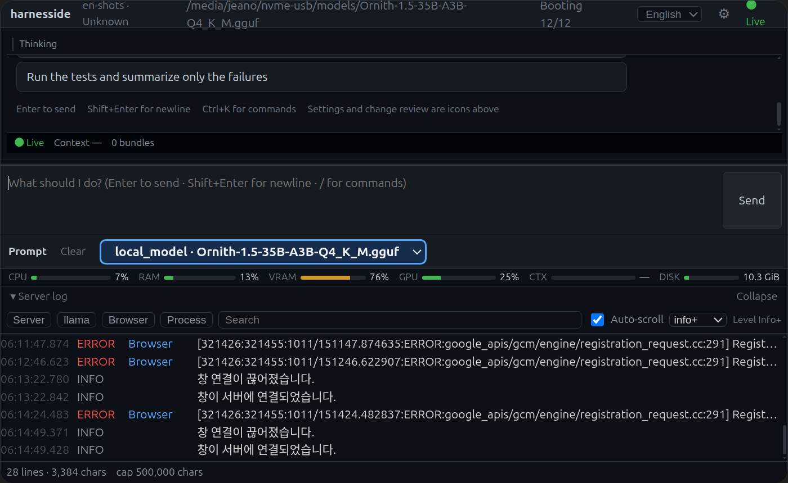

- Top header — project · **model path in use** · `Booting 12/12` · `Live`
- Three clickable example prompts, shortcut hints below
- Bottom meter bar `CPU · RAM · VRAM · CTX · DISK` — bars, not numbers

Every figure in this README is a real window captured over CDP
(`Page.captureScreenshot`), on the English default. Switch to Korean with
`/lang ko` — the same screens render in Korean.
The window contents are verifiable without figures via
`node scripts/verify-window.mjs` (see `docs/VERIFICATION.md` for what passed and
what the headless limit leaves unmeasured).

## Install

**The install path is one portable zip for your platform — nothing else.** No npm
package, no checkout-build install. Install and self-update use the same zip.

1. From [Releases](https://github.com/jeano76/harnesside/releases/latest), grab
   `harnesside-portable-<platform>-<arch>.zip`.

    | Platform | File |
    |---|---|
    | Linux x64 · arm64 | `harnesside-portable-linux-x64.zip` · `…-linux-arm64.zip` |
    | Windows x64 · arm64 | `harnesside-portable-win32-x64.zip` · `…-win32-arm64.zip` |
    | macOS Apple Silicon · Intel | `harnesside-portable-darwin-arm64.zip` · `…-darwin-x64.zip` |

    A zip from another platform will not run — its native module (`node-pty`)
    won't match.
2. Unzip anywhere. All you need is **Node 22+** (no npm).
3. Run the installer from the unzipped folder.
    - Windows: right-click `Install-Portable.ps1` → "Run with PowerShell"
    - Linux · macOS: `sh install.sh` (bash · zsh · dash · fish all fine)
4. Launch: `./harnesside.sh` · `harnesside.cmd` · desktop shortcut.

What the installer does — in order, verified by **running**, never assumed:

| Step | Contents |
|---|---|
| Check | Node ≥ 22 · zip is for **this machine's** platform · hash-check every file via `portable-manifest.json` |
| `setup` | Hardware detect → secure a **actually-booting** llama-server on this machine (CUDA → ROCm → Vulkan → CPU, Metal on macOS) → model pick + download → predictive tuning |
| `measure` | **Measured on this machine** — boots the engine, times prefill/generation tok/s and free memory over a few configs on a fixed prompt, keeps the fastest |
| Shortcut | Desktop shortcut |

`measure` results stay in `.harnesside/state/measurements.json` and
`~/.harnesside/machine-profile.json`; later boots reuse the measurements while
engine · model · context · offload match.
Install options: `--measure=full` (more candidates) · `--no-measure` ·
`--models-dir=DIR` · `--no-shortcut`. Re-measure anytime with
`harnesside measure`.

### Requirements

| | Requirement | Check |
|---|---|---|
| Node | **22+** | `node -v` |
| Browser | Chrome or Chromium | `harnesside doctor` |
| GPU | Optional — runs on CPU without one | `harnesside doctor` |
| llama.cpp · models | **Prepared by the installer** | `harnesside doctor` |

- Node 20 was measured and does not work — `node-pty` dies with SIGSEGV on exit
  and the global `WebSocket` is missing.
- `harnesside doctor` shows the same verdicts **without changing anything**.
  Unmeasured reads **unverified**, never 0 or false.
- Per-project state follows the **working directory** — each project keeps
  `.harnesside/config.yaml` · `rules/` · `skills/`.
- Uninstall: delete the folder. Also delete `~/.harnesside` to remove
  models · engines · machine profile.

### Commands

| Command | What it does |
|---|---|
| `harnesside` | Server + window boot (`up -d` for daemon without window) |
| `harnesside open` | Add a window to the running server |
| `harnesside status` · `logs [-f]` · `down` | Status · logs · graceful shutdown |
| `harnesside doctor` | Environment diagnosis (read-only; installs only with `--install`) |
| `harnesside setup` | Secure engine · models · tuning (called by the installer) |
| `harnesside measure` | Measure on this machine and record settings (`--full` · `--no-apply`) |

### Platforms and engines

The installed engine depends on the GPU. Each step is used only after it is
verified to **actually boot**.

| GPU | Engine (first match wins) |
|---|---|
| NVIDIA | CUDA prebuild (driver-matched version) → Vulkan → CPU |
| AMD | ROCm prebuild → Vulkan → CPU |
| Intel · other | Vulkan → CPU |
| Apple Silicon | Metal (CPU fallback in the same binary) |
| None | CPU |

v0.4.0 builds 6 platform zips on release runners. linux-x64 is verified through
unpack check · `node-pty` load · `doctor`; the rest meet their first CI on the
first tagged release — unverified platforms are not recorded as passing.
[`docs/PLATFORM_MATRIX.md`](docs/PLATFORM_MATRIX.md) is canonical for what was
actually measured.

## What it is

harnesside takes a prompt, streams a local LLM's reply, runs the tools that reply
asks for (file read/write/edit, shell, diff, CDP browser control), and repeats
until the model asks for no more tools. It assumes **local llama.cpp**, not a
hosted API — model weights · chat history · every file the agent read all stay on
one machine.

Most of the design falls out of that:

1. **A long-lived process, not a request-response tool.** One turn can span
   minutes of generation. So context auto-compacts, checkpoints hit disk between
   tool calls, and a crash resumes on the next run.
2. **The scarce resource is memory, not disk.** Model files run to tens of GB and
   the machine is not a datacenter. Every memory-hungry subsystem has a budget;
   on a tight-VRAM card we never boot a second llama-server — an already-running
   server is **adopted**, never killed.
3. **Never states the unknown as known.** An unmeasured value reads "unverified",
   not 0 or an estimate. Screen · `doctor` · logs all follow the same rule.

### Request flow

```
Chrome window (React SPA, src/web)
  └─ HTTP / WebSocket ──▶ daemon (src/server) — token auth, loopback only
       └─ AgentLoop (src/agent/loop.ts)
            ├─ check context usage ── over threshold ──▶ compact + checkpoint (.harnesside/state/)
            ▼
        POST /v1/chat/completions ──▶ llama-server ──▶ tool_calls?
            │                                              │ yes
            │                            run tools (src/tools: read/write/edit/shell/diff/browser)
            │                            append results, ask again ◀──┘
            ▼
        streamed reply ──▶ chat blocks ──▶ window
```

### Subsystems

| Area | Entry | Role |
|---|---|---|
| Web UI | `src/web/main.tsx` | Prompt, chat blocks, command palette, file editor, meters, settings |
| Daemon | `src/server/index.ts` | 12-step boot, HTTP routes, WS hub, terminal/PTY, approval gate, tmux CLI hosting |
| Install · engine | `src/setup/` | Hardware detect, engine ladder, model catalog/download, tuning, calibration, install-time measure (`measure.ts`) |
| Agent loop | `src/agent/loop.ts` | Turn progress, tool calls, context math |
| Compaction | `src/compaction/` | Checkpoint write/resume, transcript summarize |
| Self-improve | `src/hermes/` | Failure logs, circuit breaker, rule proposals |
| Backend | `src/backend/` | llama-server process manage, OpenAI-compatible client, server detect/adopt |
| Tools | `src/tools/` | `read_file` · `write_file` · `edit_file` · `run_shell` · `browser_*` |
| Skills · rules | `src/skills/` | Always-on rules, lazily loaded skills |
| Update | `src/server/updateService.ts` | GitHub Releases check, portable-zip verify/swap, boot confirm, rollback |
| Crash handling | `src/crashHandler.ts` | Synchronous crash log |
| i18n | `src/web/i18n/` | English-default catalogs (`en.ts` canonical, `ko.ts` mirrors it), `/lang` switch |

## Usage

This section is **how to actually use it**, not a feature list. Each figure says
what was done and what showed. What doesn't exist is **recorded as missing**.

### Capture conditions (measured)

| Item | Value |
|---|---|
| Date | 2026-10-11 (version 0.4.0) |
| Model | `Ornith-1.5-35B-A3B-Q4_K_M.gguf` 35B A3B Q4_K_M (20.4GiB) |
| llama.cpp | **Adopted an already-running server** (`127.0.0.1:8080`) — we booted none |
| GPU | Browser `off` · VRAM 85% used (8GiB card, 816MiB free) |
| Window | 1400×860 · settings/editor only 1400×900 |
| Language | English default (`/lang` shows `en`; Korean via `/lang ko`) |
| Verify | `scripts/verify-window.mjs` passes (1 headless-limit item unmeasured) |

Not booting a new `llama-server` is on the screen itself. Two of them on an 8GiB
card OOMs instantly — measured, not guessed, so the program stops itself.

### 1. First window


- Top: project name · **model path in use** · `Booting 12/12` · `Live`
- Not an empty screen but **three clickable example prompts**
- Shortcut hints below — clicking an icon opens the same thing
- Bottom **meter bar** `CPU · RAM · VRAM · CTX · DISK`: bars, not numbers, so
  overload shows first
- `Prompt target` under the input — always visible, where the prompt goes

### 2. Slash commands — menu, scroll, help

Typing `/` in the input offers this program's commands.

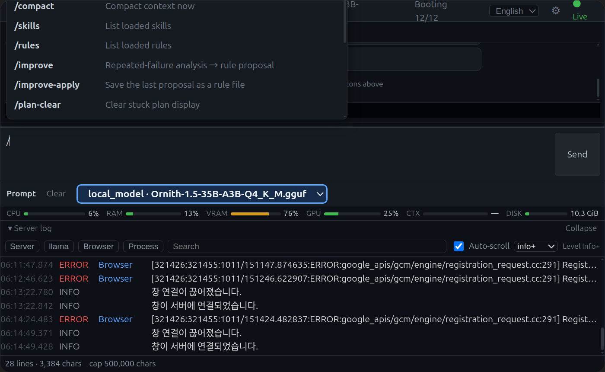

- `↑` `↓` pick, `Tab`/`Enter` **completes**, `Esc` closes
- Scrolling down, the **list follows the selection**

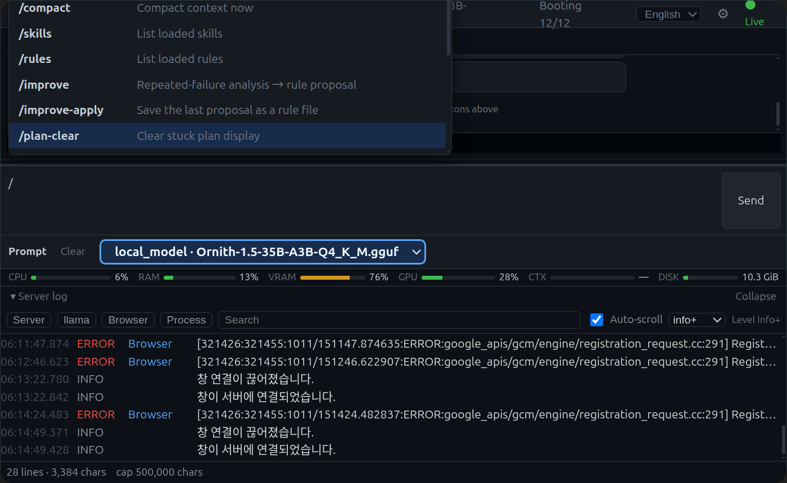

Measured: 15 items · 26px rows · 240px window · 384px total.
Scrolling first moves at the 9th row (selection at 234–260px) with `scrollTop`
21. **It does not move while the selection is still visible** — moving only as
needed is the intent.

`/help` prints the full list **grouped by role**.

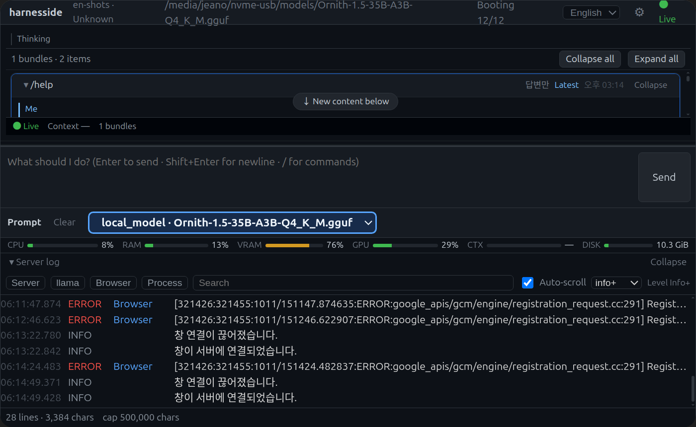

The last line is this program's attitude:

```
3 commands unavailable in this window: /keys /copy /mouse
  — console (TUI) only; that UI was removed on 2026-10-04.
```

It doesn't pretend they don't exist — it says **how many and which**.

#### All commands (15 in the web window / 18 registered)

| Command | What it does |
|---|---|
| `/help` | This program's command list |
| `/lang` | Switch interface language (`en` · `ko`) — applies now, remembered |
| `/models` | Runnable local models on this PC · swap |
| `/server` | Model server status · `restart` to reboot · `calibrate` to re-measure (after confirm) |
| `/reset` | Recompute model/settings for current GPU·VRAM·RAM |
| `/term` | Detected terminal and feature status |
| `/cli` | Open an AI CLI in a tmux tab · list · kill |
| `/skills` | Loaded skill list |
| `/rules` | Loaded rule list |
| `/improve` | Analyze repeated failures into a rule proposal |
| `/improve-apply` | Save the last proposal as a rule file |
| `/compact` | Compact context now |
| `/queue` | Show the queue |
| `/plan-clear` | Clear a stuck plan indicator |
| `/quit` | Quit cleanly (**twice within 15s** — never quits unconfirmed) |

`/keys` · `/copy` · `/mouse` are registered but not in the web window.
Their names stay **with the reason** — users go looking for missing commands.

`/models` · `/server` · `/reset` · `/cli` take **arguments**, so typing further
offers the next-step candidates (`1`·`2`·`confirm`).
Swapping is split into preview → `confirm`, two steps.

#### `/server calibrate` — re-pin from measurement, not prediction

`-ngl` · context · `--n-cpu-moe` start as **predictions** from card + model size.
`/server calibrate` remeasures with the server **up** and recomputes.

| Measures | How |
|---|---|
| Free VRAM on card · VRAM held by server | `nvidia-smi` (per pid) |
| KV cost per token · layer count · trained context | GGUF header |

Same prompt, same box (RTX 2070 SUPER 8 GiB · Ornith 1.5 9B Q4_K_M), before/after:

| | Offload | Server VRAM | Card free | Prefill | Generate | Context |
|---|---|---|---|---|---|---|
| Before `-ngl 32 -c 36864` | `32/34` | 5,588 MiB | 2,064 MiB | 197.1 tok/s | 41.33 tok/s | 36,864 |
| After `-ngl 999 -c 81920` | `34/34` | 6,808 MiB | 844 MiB | **482.5 tok/s** | **61.25 tok/s** | **81,920** |

Rules:

- **Free VRAM is spent once.** What `-ngl` takes, context cannot.
- **A live safety margin is never trimmed.** Trimming happens only when the
  margin already broke, and only by the shortfall.
- **Changed values go preview → `confirm`.** If the new settings fail to come
  up, the previous settings reboot and nothing is written to config.
- **Unmeasured means unchanged.** "Nothing to change" (optimal) and "cannot
  measure" (unknown) are different sentences.

`/server restart confirm` and `/models <n> confirm` auto-run the same calibration
once after. Install-time `harnesside measure` compares **throughput** (thread
counts etc.) on top of this calibration.

#### `/lang` — English default, Korean one command away

The interface ships in English. `/lang` with no argument shows the current
language and usage; `/lang ko` switches to Korean immediately, `/lang en`
switches back. The header language selector does the same thing. The pick is
stored in the browser (`localStorage`) and restored on the next window. The
agent's answer language follows the user — English unless you write in another
language.

### 3. Slash command results

Commands **don't call the model.** The server reads the canonical state and draws
immediately. That is the pleasant part.

**`/models` — what can run on this PC**

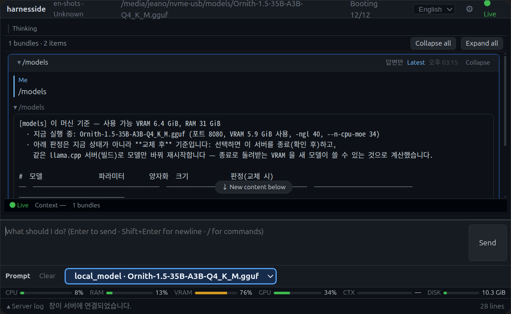

- The **currently running model** with its conditions as-is (port 8080 ·
  6.1GiB VRAM · `-ngl 999` · `--n-cpu-moe 33`)
- Each list row wears a status badge — 35B MoE is ⚠ **RAM streaming**, 9B is ✅
  VRAM
- Picking means **bringing the live server down and up**, so the diff preview
  comes first and `confirm` is required
- Swap is two steps: `/models <number>` → `confirm`

**`/term` — the window describes itself**

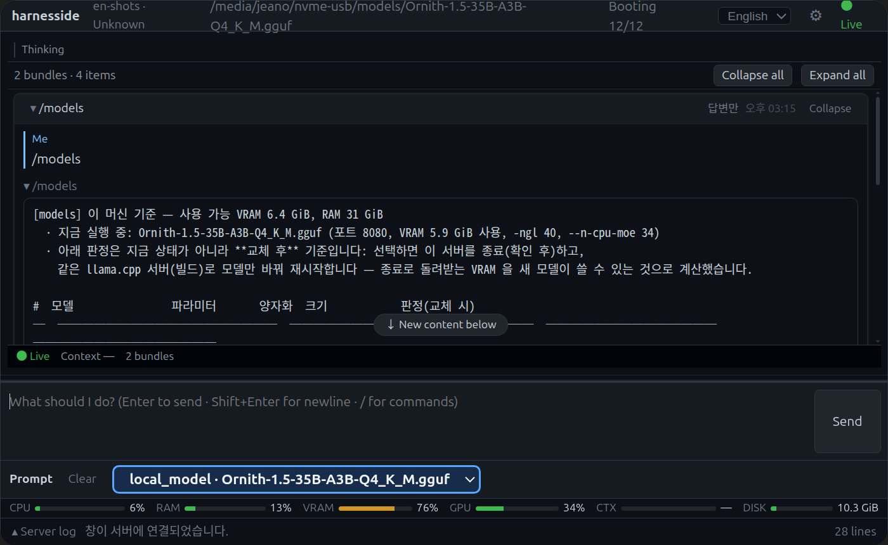

```
Window      : web browser (not a console terminal)
Browser     : ... Chrome/153.0.0.0 ...
Screen      : 1400×860px · ratio 1 · 24bit color
Mouse       : always on
```

**`/skills` · `/rules` — what does this project know**


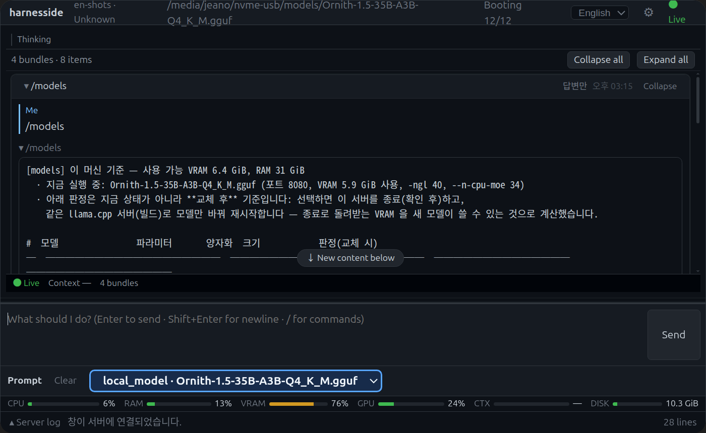

Both read `.harnesside/skills/*.md` · `.harnesside/rules/`.
`.clinerules` is read too. With no files they say **"none"** — an empty list is
never dressed up as "ready".

**`/lang` — what language is this**

With no argument it answers with the current language and usage
(`Interface language: en (available: en, ko). Usage: /lang <en|ko>.`).
`/lang ko` replies `화면 언어를 ko(으)로 바꿨습니다.` — in Korean, because the
reply renders in the new language — and every catalog string on screen flips
with it.

### 4. Settings — models and updates

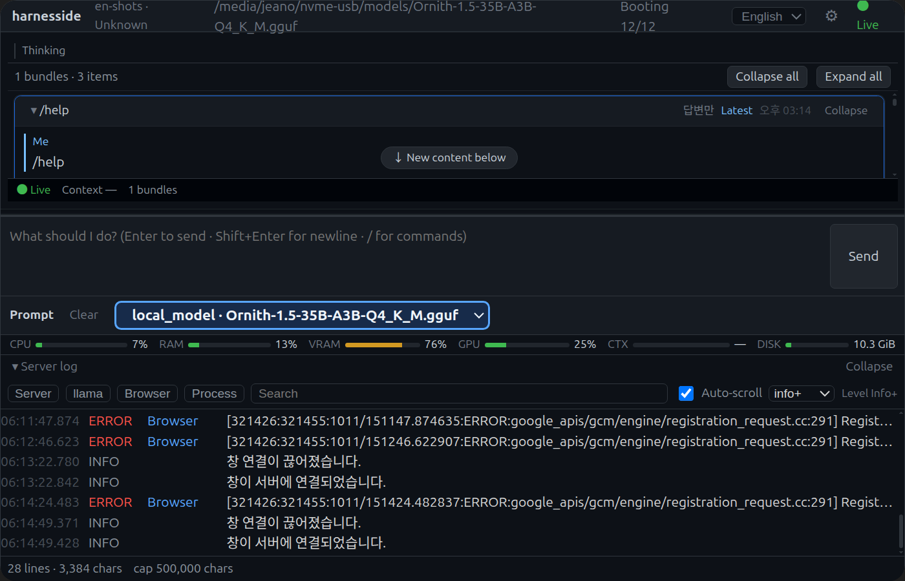

**Models**

- `Storage dir` and `in use` paths shown **separately** — together they confuse
- `Using an already-running service` — the **adopt path**. A server we didn't
  boot is **never killed**. The boot log records the fact
- HuggingFace search and `sequential download` guidance

**Updates**

Shows installed version · build identity (date · commit) · **install hash** ·
install path. The install hash is a **tree hash** of the install folder's
`dist/` · `node_modules/` against `portable-manifest.json` — not one file.
When it can't compare (dev runs etc.) it says "unverified", never a 0 or a
plausible-looking hash. A clean tree prints no `dirty` — only anomalies speak.
A new version offers **only this machine's zip** as a button. (Figure is 0.2.0.)

### 5. Command palette

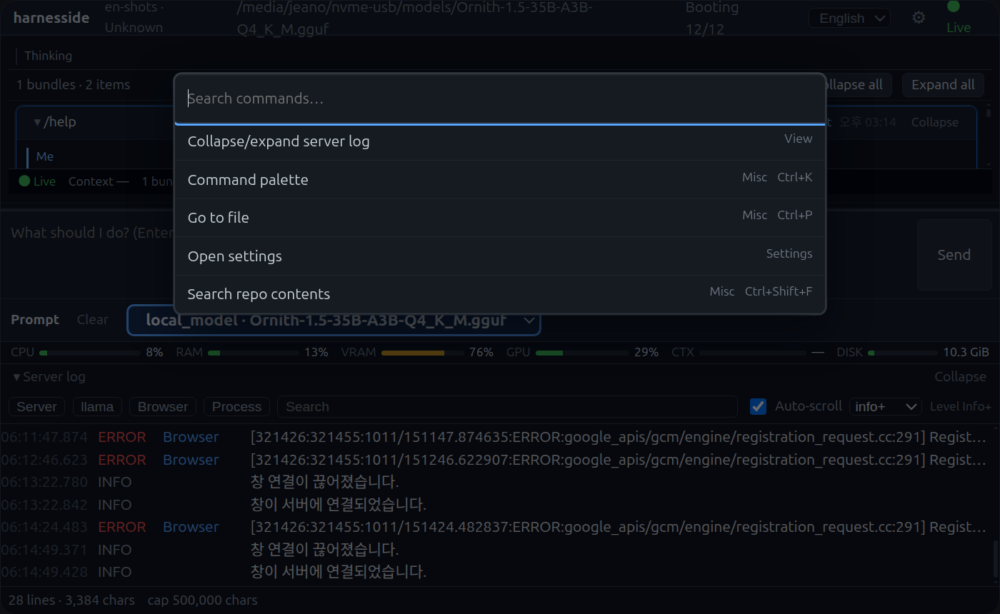

`Ctrl+K` commands · `Ctrl+P` jump to file · `Ctrl+Shift+F` content search. One
palette shell with different list sources — run command, open file,
`path:line` hit open, and "truncated" marks all work with arrows + `Enter`.

### 6. Server log — why boot went that way

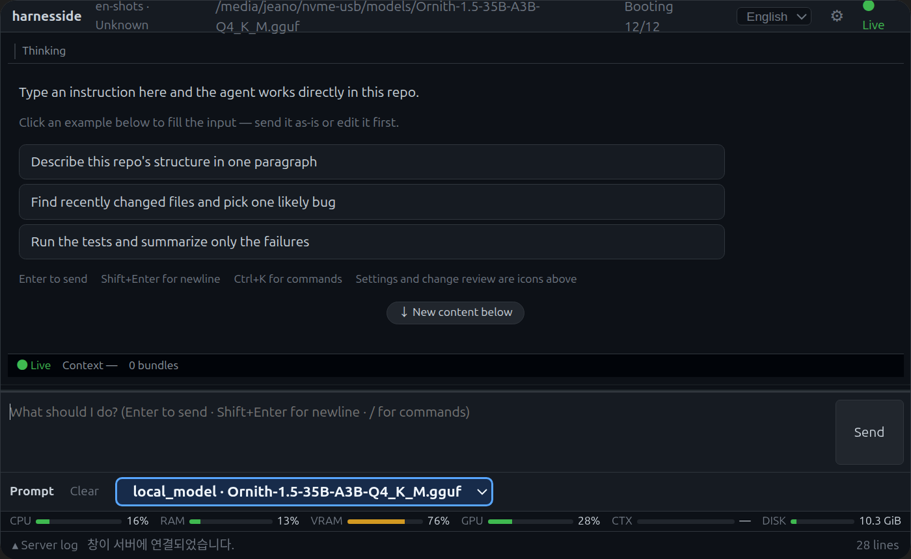

`▴ Server log` shows the 12 boot steps **verbatim**.
Filter by `server / llama / browser / process`, narrow by level and line count.
Footer `4 lines · 3,656 chars · cap 500,000 chars` — the numbers say it keeps
**accumulating while collapsed**.

### 7. Putting the agent to work

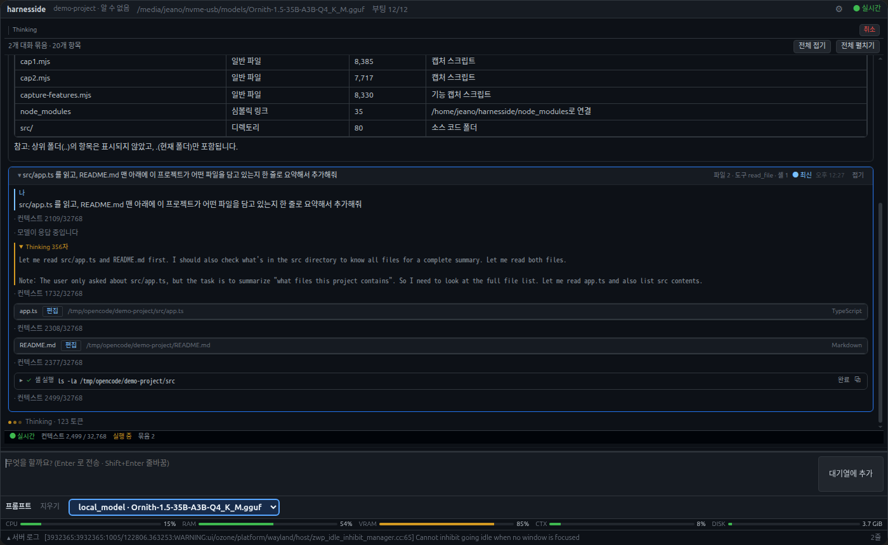

One turn looks like this:

- Turn header: what the human did · `2 files · read_file tool · latest` · elapsed
- `Thinking 356 chars` — reasoning **shown but foldable**
- File chip `edit app.ts · /…/src/app.ts · TypeScript` — path plus language
- `✓ Run shell ls -la … /tmp/opencode/demo-project/src` · `Done` badge
- `Context 1,732/32,768` — the numbers visibly move per tool call
- While running, Send becomes `Add to queue` — **accepted, not refused**

Then the actual edit result.

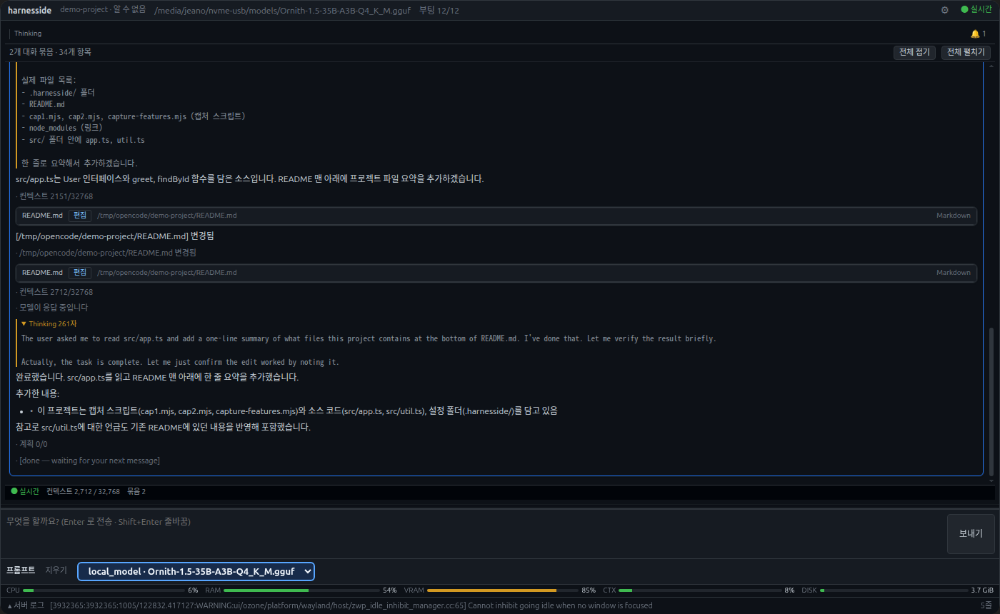

In this figure the **35B model dropped a file from the list.** The screen doesn't
cover it up — `edit_file` shows what it wrote. A screen that hides model
mistakes doesn't help — **the user must be able to check directly.**

Shell runs, isolated:

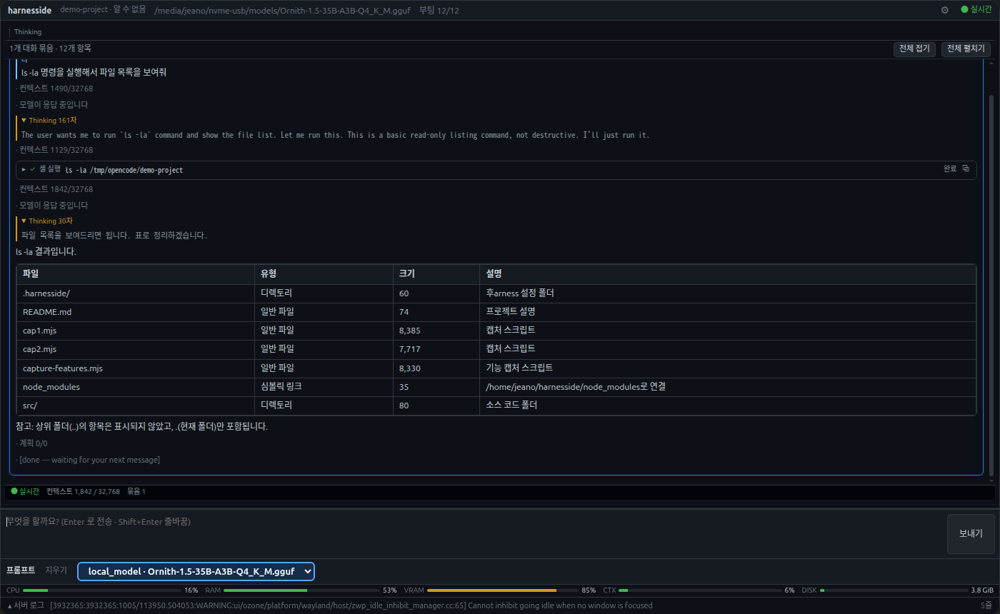

`Original` / `Answer` open **what the model saw vs actual output** separately.
Markdown tables render.

### 8. Open and edit files

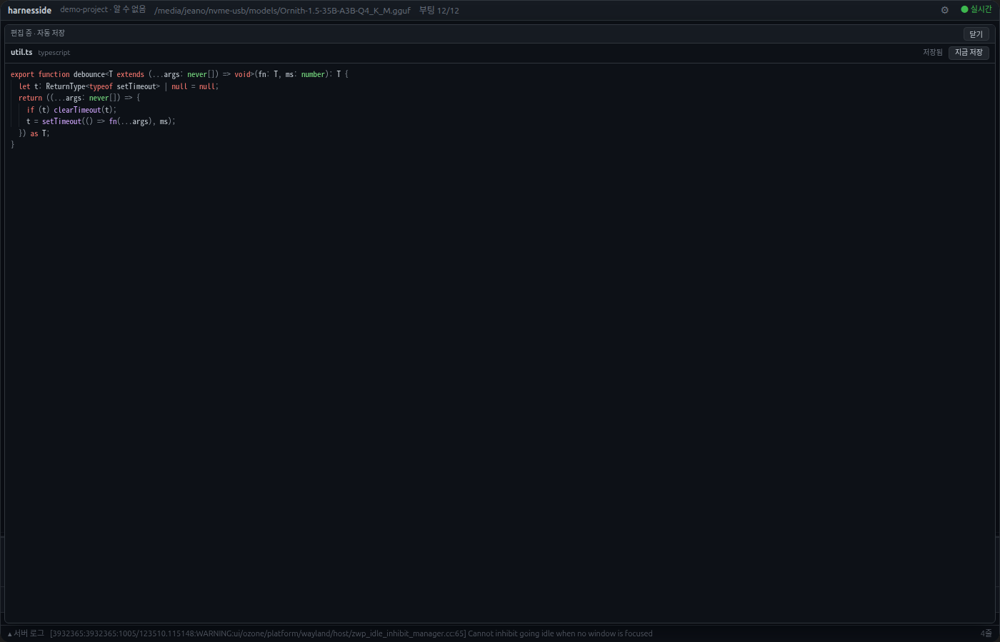

The tool chip's `Edit` opens it. **Not a separate panel — overlaid on the chat.**
`Editing · autosave` · `Saved (version)` · tab with path and language · `Close`.

**Autosave** actually runs — 1.5s after typing stops, a PUT hits disk and the
header flips to `Saved (v…)` (measured: on disk within 2.5s).

**When the file changed outside** — two branches, because touched vs untouched
differ:

- **Untouched** → follows disk (measured: reflected within 2s)
- **Editing** → **never overwrites.** Autosave sees the server's new version,
  takes the 409, says it **will not auto-overwrite**, and offers choices

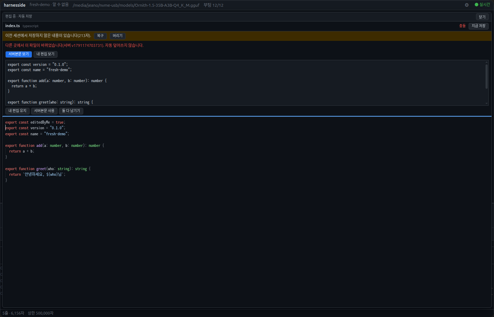

```
This file changed elsewhere (server v1791174703731). Not auto-overwriting.
[See server text] [See my edit]      ← compare with eyes first
[Keep my edit] [Use server text] [Keep both]
```

Version number included — not "who changed it when" but **which version is the
baseline**, so the conflict resolves immediately. The eyeball-compare buttons sit
on top for a reason.

### 9. Prompt target — local model and AI CLIs

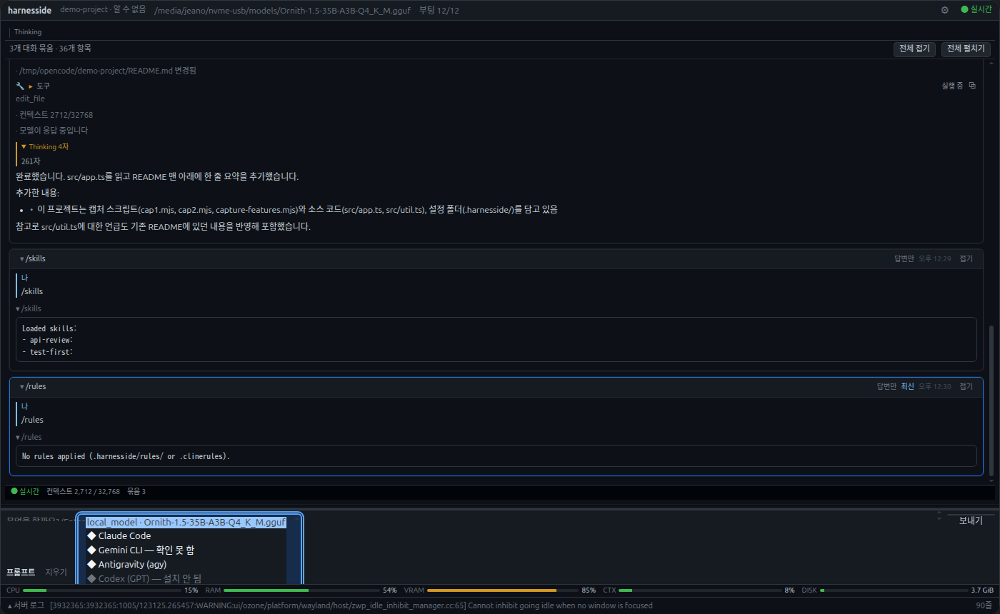

Default is **this PC's local model**. The picker can send to an AI CLI already in
the user environment, opened side-by-side in a tmux tab.

```
◆ Claude Code
◆ Gemini CLI — unverified
◆ Antigravity (agy)
◆ Codex (GPT) — not installed
```

`Not installed` and `unverified` are **different states**. The first is **known
absent**, the second **unknown**. Never blurred into one phrase.

### 10. Narrow window

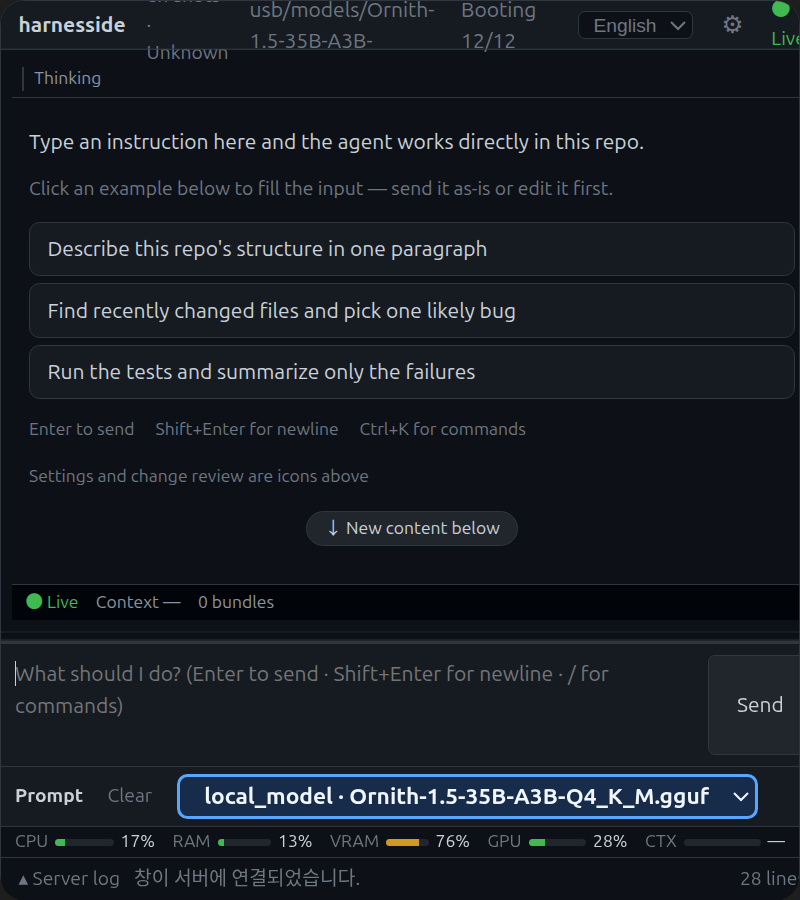

At 800px no horizontal scroll appears (measured: `scrollWidth <= clientWidth`).
This is the **window itself shrinking**, not the 1600×1000 Chrome launch window.

### 11. Two at once

Each project owns separate `.harnesside/` state, so **instances are separate**.
And each instance owns **its CDP port and Chrome profile**.

Measured: working project 7317 · this document's project 7318 · new project
7319, CDP on 9222 · 9223 · 9224, fully separated.

An unnamed CDP port takes a free one. Naming one with `HARNESSIDE_CDP_PORT`
that's already held by another instance **stops instead of silently switching**
— not opening beats opening the wrong window.

### What you usually do → how

| Want | How |
|---|---|
| Find files | "Find the most recently changed files" · "Run the tests and keep only the failures" |
| Understand code | "Read src/app.ts and explain what this function does" → chip `Edit` for source |
| Fix | "Change …" → check the `edit_file` result → "Revert that part" if off |
| Measure | "Run ls -la and show me", "Run the tests" |
| Tidy mid-way | `/compact` · auto-compact runs first on long jobs · `clear` resets chat |
| While waiting | Send becomes `Add to queue` · `/queue` shows the order |
| Find commands keyboard-free | `Ctrl+K` · slash with `/` in the input |
| Switch language | `/lang ko` · `/lang en` · header selector (remembered) |

### When the reasoning budget blows

A cap stops the model **thinking without doing anything** all turn.
Past it, **this turn flips from "thinking" to "direct tool calls".** The cap is
`agent.maxReasoningTokens` in `.harnesside/config.yaml`.

```
Reasoning budget exceeded → switching to tool calls (66/64·estimated)
```

What happened · what happens next · that the numbers are estimates — all said
together. The answer language stays the user's language either way.

### Input box — hints · height · history

The input carries two facts in its **hint text**:

```
What should I do? (Enter to send · Shift+Enter for newline · / for commands · ↑↓ past prompts)
```

- `/ for commands` — 15 slash commands, right from the input
- `↑↓ past prompts` — appended only after at least one prompt was sent

**Default height is 2 rows (104px)**, handle-adjustable in 18px row steps.
Minimum 1 row (70px).

### Shortcuts

| Key | Action |
|---|---|
| `Enter` | Send · with the slash menu open, **completes first** |
| `Shift+Enter` | Newline |
| `Ctrl+K` · `Ctrl+P` | Command palette |
| `↑` `↓` | **Prompt history** — recalls past prompts (next section) |
| `↑` `↓` (menu open) | Move slash candidates — **beats history** |
| `Tab` | Complete the candidate into the input |
| `Esc` | Close menu · palette · abort the running turn |
| `Alt+` `←` `→` `↑` `↓` | Move panels |

### Prompt history — `↑` `↓`

`↑` in the input **revives the past prompt.** `↓` goes the other way, and past
the newest the **half-written sentence from before browsing** returns.

Not the shell's unconditional past. **The cursor line goes first:**

- `↑` goes to history only when the cursor is on the **first** line
- `↓` advances only when the cursor is on the **last** line

So editing a two-line prompt body never gets interrupted by the past.
Adding a feature never breaks editing.

`/` opens the slash menu, where `↑` `↓` mean **candidate moves** — the narrower,
more urgent need always wins. `Esc` closes the menu and history is back.

Two identical sends in a row recall **once**. But spaced-out duplicates are
**kept** — "1 · 2 · 1" were all actually sent.

## Structure

Re-pulled from the filesystem (**2026-10-11**, v0.4.0). LOC excludes tests
(`*.test.ts`); tests are **200 files · 2485 cases**.

```
src/  52,187 total (non-test)
  server/     15,019  daemon: 12-step boot, HTTP routes, WS hub, terminal/PTY, approval gate,
                        updater (portable zip), tmux CLI hosting, parent watchdog
  setup/      12,778  hardware·CPU·shell detect, engine ladder, model catalog/download,
                        tuning, calibration, install-time measure
  web/        12,225  Chrome window React SPA: agent panel, IDE frame, editor, meters, settings
  agent/       2,524  turn loop: tool-call stream, retry/loop detect, plan progress
  backend/     1,439  OpenAI-compatible client + llama-server manage·detect·adopt
  tools/       1,209  read/write/edit/run_shell, diff render, CDP browser tools
  models/        983  HuggingFace search, hardware fit score, resumable download
  compaction/    983  context summarize, checkpoints, durable notes
  session/       903  chat blocks (canonical), session save, autosave
  shared/        851  import-free pure data: slash commands, CLI providers, meter format, symbol extract
  config/        793  settings schema, per-value provenance
  git/           506  status/diff/commit/push — redact + stop on conflict
  fs/            501  root-escape path guard, whole-repo search
  hermes/        229  circuit breaker, failure log, rule proposal loop
  auth/          213  bearer token, loopback Host/Origin allowlist
  skills/        207  rule/skill search over 8 existing AI CLI conventions
.harnesside/          per-project state (git-ignored)
  config.yaml         backend/model/tuning/compaction settings
  rules/ · skills/    project rules · trigger-based skills
  state/              checkpoints, instance lock, server log, measurements
~/.harnesside/        machine scope: models, engine prebuilds, machine-profile.json
```

Reproduce:

```bash
find src -name '*.ts' -o -name '*.tsx' | grep -v '\.test\.ts$' | xargs wc -l | tail -1
find src scripts -name '*.test.ts' | wc -l
```

Design rationale · module notes · Hermes loop: [`docs/ARCHITECTURE.md`](docs/ARCHITECTURE.md).

## Built-in skills

`src/skills/builtin/` ships **9** fixed skills: `architecture-design` ·
`planning` · `implementation` · `code-review` · `whitebox-testing` ·
`blackbox-testing` · `static-analysis` · `security` · `web-publisher`. Each is a
plain skill file (trigger + body), so a project's `.harnesside/skills/*.md` can
override or extend them.

**Not shown under `/skills`.** That command shows only the project's
`.harnesside/skills/*.md`. Built-ins go **model-side** — the index joins the
system prompt and the model pulls bodies via `load_skill`.

## Releases and updates

Versions are **two layers**. The release id is SemVer (`package.json`); build
identity is **date+commit**, baked into the code per release (an installed
distro has no git repo to ask for a commit).

```
release id   0.4.0              ← package.json. Canonical. Update compares this.
build id     20261006-d29496e   ← dist/server/buildInfo.json. Screen·logs·verify read this.
```

Design background: [PROMPT_RELEASE_SELFUPDATE.md](PROMPT_RELEASE_SELFUPDATE.md),
platform/engine roadmap: [PROMPT_PLATFORM_ENGINES.md](PROMPT_PLATFORM_ENGINES.md).

### Distro — one portable zip

```bash
npm run portable                              # build + release/harnesside-portable-<platform>-<arch>.zip
node scripts/make-portable.mjs --verify-repro # build twice, compare bytes (reproducibility)
cd release && sha256sum -c harnesside-portable-*.zip.SHA256SUMS
```

| File | Contents |
|---|---|
| `harnesside-portable-<p>-<a>.zip` | Whole install folder: `dist/` · production `node_modules/` · launchers · install scripts · `portable-manifest.json` |
| `….zip.manifest.json` | The manifest above + **the zip's own sha256** — a zip's manifest cannot hold its own zip hash |
| `….zip.SHA256SUMS` | For `sha256sum -c` |

Zips are written **reproducibly** (sorted order · fixed timestamps · no external
zip binary). `node_modules` holds native modules, so each zip is built **on its
platform's runner**.

### Publish

Pushing a `v*` tag runs `.github/workflows/release.yml`. A gate must pass first
(typecheck · unit tests · static checks · coverage floor · **reproducibility** ·
**self-update measurement**), then platform zips build:

| Platform | Runner | Required | v0.4.0 |
|---|---|---|---|
| `linux-x64` | `ubuntu-latest` | Yes | Build · unpack-run pass |
| `win32-x64` | `windows-latest` | No | Unmeasured (first CI on first tag release) |
| `linux-arm64` | `ubuntu-24.04-arm` | No | 〃 |
| `win32-arm64` | `windows-11-arm` | No | 〃 |
| `darwin-arm64` | `macos-15` | No | 〃 |
| `darwin-x64` | `macos-15-intel` | No | 〃 |

Each runner unpacks its zip and runs install check · `node-pty` load ·
`--version` · `doctor`. A required-platform failure blocks publish; an optional
one ships the release **noting the failure** without that zip. **Branch pushes
build nothing.**

### What an update actually swaps

- Takes only its own `<platform>-<arch>` zip. A foreign-platform zip, or a
  same-named zip whose manifest declares another platform, is refused **before
  download**.
- **The swap covers the install folder's `dist/` and `node_modules/` whole.**
  Dependency modules come with the new version. Old files missing from the new
  tree are cleaned inside those two folders.
- **User state (`.harnesside/`) and user files are untouched.** The rollback
  slot holds distro scope only.
- **Nothing is overwritten before verification.** Manifest receive → zip receive
  → hash compare → unpack → list compare must all pass before slotting. Unchanged
  files aren't rewritten; Windows-locked native modules are sidestepped.
- Skipped when the install folder is a git checkout.
- **Auto-confirm/rollback only happens under a supervisor** (next section).
  A plain run (`harnesside`) can't restart itself, so an unconfirmed boot reports
  "update unverified" with the slot path on the next run — never auto-rolls back.
- ≤0.3.x installs (tar.gz self-update) can't auto-take 0.4.0 — reinstall from zip.

### Supervisor — relaunches when dead

A plain run has no supervisor. Launched under one, crash restarts and
update confirm/rollback are its job:

```bash
node dist/server/supervise.js --daemon --no-browser   # server args pass through to the child
```

- Boots the child (adjacent `dist/server/index.js`) and confirms boot over
  `/api/health`. Port file and boot time must match — a stranger server is never
  trusted as its child.
- Exit 0 and stop requests don't relaunch. Abnormal exits relaunch with
  exponential backoff, stopping past the window cap (default 5/5min). Exit codes:
  0 (clean/stop) · 1 (halted) · 2 (usage error).
- Under a supervisor, confirming `/api/update/apply` swaps + marks and exits
  42; the supervisor reboots into the new version. A consumed marker confirms; a
  leftover marker rolls back from the slot and boots the old. A failed rollback
  halts.
- Measured (2026-10-09): 1 confirmed boot → SIGTERM clean exit in 2s, exit 0,
  port reclaimed.

### Must know

**A hash is not a code signature.** A hash proves *bytes are undamaged* and
*which commit at which time made these bytes*. It does not prove **the bytes
are trustworthy**. A stolen repo account lets an attacker recompute a matching
hash for their own code.

### Check it yourself

```bash
npm run verify:selfupdate
```

Runs the whole path on a real portable zip with 0 network: install build A →
take B and verify → apply (deps included) → roll back and compare **byte for
byte** with A, user state in the install folder intact, a one-char-off hash and
a foreign-platform zip **swapping nothing**, and dead network never reading
"latest".

## Develop

A checkout run is for development — not an install path.

```bash
npm ci
npm run dev                 # server :7317 + Vite :5317, both watch
npm test                    # unit tests (node:test, tsx)
npm run typecheck
npm run portable            # build + release/harnesside-portable-<platform>-<arch>.zip
npm run verify:selfupdate   # full self-update path on a portable zip, measured
```

Language files: `src/web/i18n/en.ts` is canonical (English default);
`src/web/i18n/ko.ts` mirrors it key-for-key (checked by
`src/web/i18n/i18n.test.ts`). Add a UI string by adding the key to **both**.

## Verify

What was actually checked, what wasn't, and the numbers:
**[docs/VERIFICATION.md](docs/VERIFICATION.md)** · per-platform measurements:
**[docs/PLATFORM_MATRIX.md](docs/PLATFORM_MATRIX.md)**. Read those before trusting
any number quoted here.

Design rationale · module notes · bug history:
**[docs/ARCHITECTURE.md](docs/ARCHITECTURE.md)** ·
**[docs/IMPLEMENTATION-HISTORY.md](docs/IMPLEMENTATION-HISTORY.md)**
